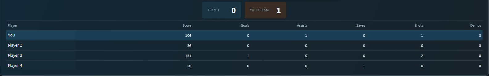

# Rocket League Tracker

A free local Windows companion for Rocket League: capture observed matches, review sessions, and export your history. Application source is maintained separately; this repository contains public downloads, the website, and support materials.

[Website](https://rlstattracker.link/) · [Download for Windows](https://github.com/Garre-tt/RL-tracker-public/releases) · [Report an issue](https://github.com/Garre-tt/RL-tracker-public/issues)

## Features

- Separate playlist records per play session and past game details.
- Available live scoreboard statistics and lifetime ranked Overview.
- Account-scoped local history, result corrections, and CSV exports.
- Portable backup and restore. No website or tracker login required.

The tracker records matches it observes, not games played before capture. Confirmed rating checkpoints are supported; projected rating is unavailable. Missing or unsupported capture evidence remains unavailable or flagged for review. Analytics and teammate insights are exploratory ideas, not current features or dated commitments.

## Get started

1. Download a Windows x64 package from [Releases](https://github.com/Garre-tt/RL-tracker-public/releases). Beta builds are prereleases. Run the Setup installer, or extract the portable ZIP into a folder you can keep. For portable use, keep all companion files and `wwwroot` beside `RocketLeagueTracker.Desktop.exe`.
2. Open `RocketLeagueTracker.Desktop.exe`. The .NET runtime is bundled; the interface requires Microsoft's [Edge WebView2 Runtime](https://developer.microsoft.com/microsoft-edge/webview2/).
3. Complete setup to enable Rocket League's local Stats API and confirm your game account. If setup changes the API setting, restart Rocket League while leaving the tracker open.
4. Leave the tracker running while playing.

History and settings stay under `%LocalAppData%\RocketLeagueTracker\Tracker`. Quit the tracker from its tray before replacing an app folder during an update; keep the data directory. Back up from Settings before moving machines or restoring history.

## Support

[Report an issue](https://github.com/Garre-tt/RL-tracker-public/issues) with expected/observed behavior and app version. Redact player names and identifiers from screenshots. Do not attach raw game logs, credentials, or unfiltered API payloads.

[Buy me a coffee](https://buymeacoffee.com/garrerrac) is optional support. The app remains free.

## Maintainer documentation

[Deployment docs](docs/DEPLOYMENT.md) cover website packaging, hosting, and historical release verification. Documentation edits do not deploy changes to the Amplify website.

Independent community project. Not affiliated with or endorsed by Psyonix or Epic Games.
